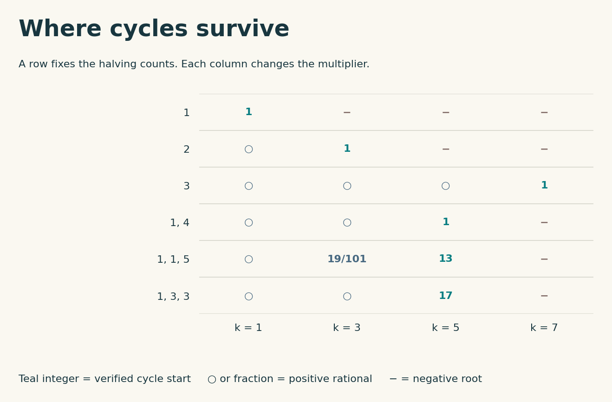
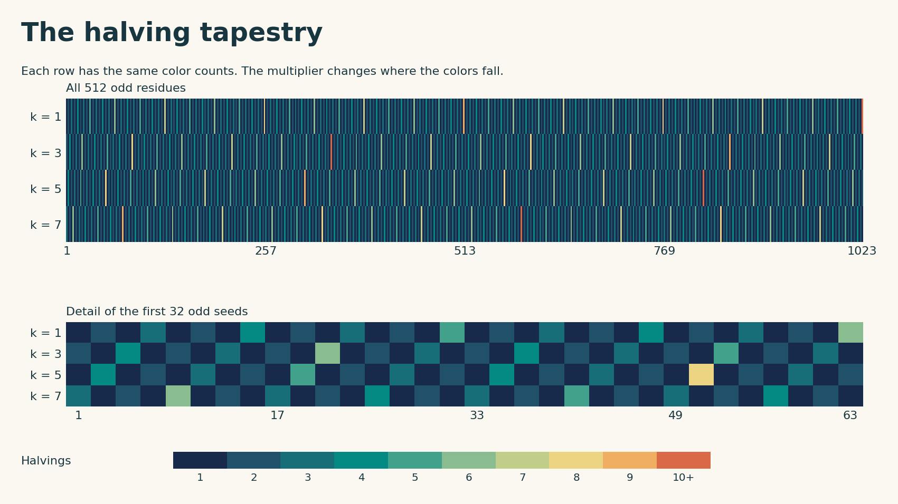
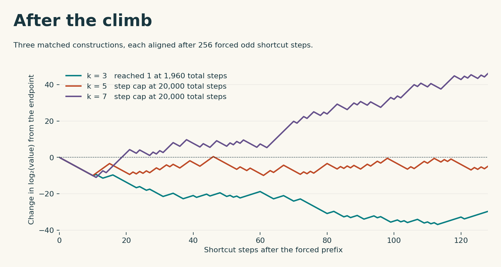
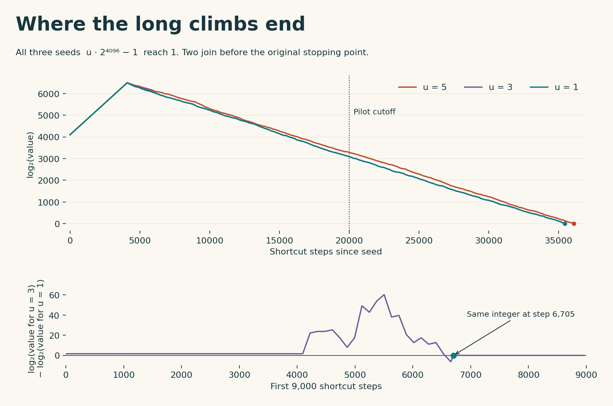

# Comparing the multipliers

Rebuild all four figures in PNG and SVG and the exact atlas data from the repository root with Python 3.13 and Matplotlib 3.10.8. Set up the plotting dependency with `python -m pip install matplotlib==3.10.8`. The arithmetic scripts run independently of Matplotlib.

```powershell
python escape.py
python continuation.py
python figures.py
```

## Where cycles survive



**Read across a row to hold the halving pattern fixed.** The rows were discovered by starting at every odd seed from 1 through 255 and watching up to 128 odd-to-odd steps for a repeat at each multiplier. Equivalent rotations share one row. For each cell the program solves the affine closure equation exactly. It verifies every positive integer solution by replaying the halving counts. This is a bounded collection of observed recipes.

For `(1,1,5)`, the formal starting value is `(k²+2k+4)/(128−k³)`. At 5, the odd values are 13, 33, 83, 13. At 3, the same recipe would require the fraction 19/101. [Scalable figure](cycle-atlas.svg) · [Exact cell values](../results/atlas.json)

## The halving tapestry



The horizontal coordinate is the odd seed. Each color encodes the number of times 2 divides `k*n+1`, capped at 10. Across the 512 odd residues modulo 1024, multiplication by any odd `k` permutes the residues. Adding 1 produces exactly the even residues. Each row therefore contains 256 cells with one halving, 128 with two, and just one with ten or more. Following one orbit selects a particular sequence of cells, which can differ substantially between multipliers. [Scalable figure](halving-tapestry.svg)

## After the climb



Here `u=1`, `j=8`, and each construction forces 256 consecutive odd shortcut steps. The horizontal origin is the resulting **even endpoint**. A vertical change of +1 means doubling, and −1 means halving. The panel shows the next 128 shortcut steps. The legend gives the later terminal event using total shortcut steps since the seed. Round-two numerical controls start at the first **odd** endpoint after the intervening halvings, a different alignment recorded in the data. Each curve follows one integer. [Scalable figure](after-the-climb.svg) · [Orbit data](../results/escape.json)

## Where the long climbs end



The top panel follows the three starts `u·2^4096−1` through arrival at 1, sampling every 128 shortcut steps and at recorded landmarks. The bottom panel compares the values of the first two trajectories at equal shortcut times. Their first shared shortcut state at step 6,705 was checked by exact integer equality. [Scalable figure](completed-paths.svg) · [Continuation and step counts](../research/continuation.md)
