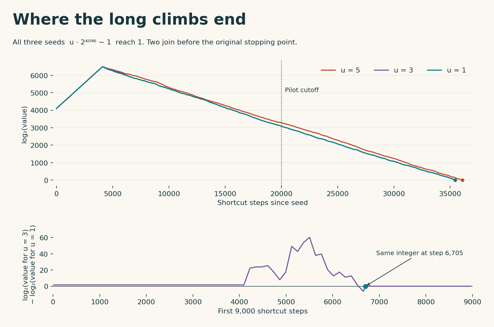

# Completing the three capped paths

The pilot stopped three positive $3x+1$ starts at 20,000 shortcut steps. Before the follow-up runs, the prediction was that all three would reach 1 within **100,000 additional shortcut steps**, without visiting a target of the form $u'\,2^{8192}-1$ for $u'=1,3,5$. All three reached 1 and missed those targets. Together with the pilot, this settles every one of the 18 structured starts at multiplier 3.

| Seed | Shortcut steps after cutoff | Total shortcut steps | Total standard steps |
|---|---:|---:|---:|
| $2^{4096}-1$ | 15,469 | 35,469 | 55,263 |
| $3\cdot2^{4096}-1$ | 15,469 | 35,469 | 55,262 |
| $5\cdot2^{4096}-1$ | 16,099 | 36,099 | 56,289 |

The first two seeds visit the same 5,890-bit integer at shortcut step 6,705 in both paths. They were already the same experiment by the old cutoff. The third first shares a shortcut state with them at 20, arriving there at its step 36,093. The discrepancy of one standard step between the first two rows comes from their different pre-merge histories.

To reproduce, run `python continuation.py` and `python figures.py` from the repository root. The continuation uses the integer and counters saved at the cutoff. A separate implementation follows the standard map from the original seed and checks every resumed shortcut state, cumulative peak and step count. It stops at 1, an exact repeat, or the new budget. Every positive-time shortcut state was checked against all three odd targets. [Exact counts, shared states and plot data](../results/continuation.json) · [Scalable figure](../figures/completed-paths.svg)

## What a new escape candidate would need

The [two-climb construction](recharge.md) can send a seed with a controlled first climb into a much longer second one. It lands on a pure Mersenne seed and the long-climb pattern breaks. A more decisive target is a family $F(m)=u(m)2^m-1$, with positive odd $u(m)$, for which the next odd state is again $F(m')$ with $m'>m$. The identity to prove along one continuing sequence is

$$3^m u(m)-1=2^{t_m}\big(2^{m'}u(m')-1\big),\qquad t_m=v_2(3^mu(m)-1).$$

A solution at one pair of indices is a finite transition. A rule that proves it at every successive index from an explicit start would yield an unbounded sequence of positive checkpoints along that one orbit.
